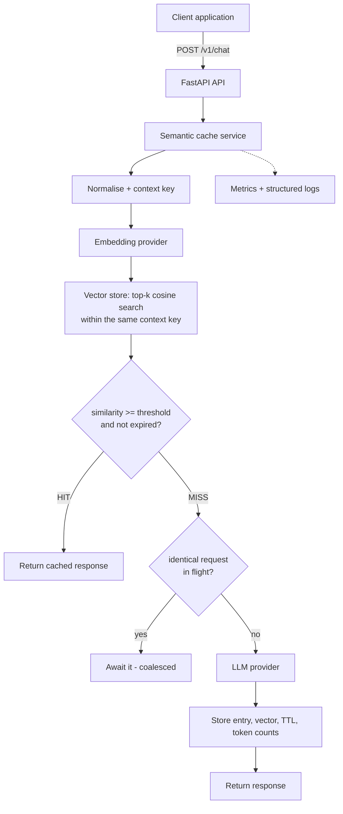

# LLMOPS — Semantic Caching Layer for LLM APIs

[](https://github.com/GIRISHKUSANURAMATH/llmops-semantic-cache/actions/workflows/ci.yml)


A FastAPI service that sits between your application and an LLM API. When a new prompt is
*similar enough* to one answered before - by embedding cosine similarity, and only under the
same provider, model, system prompt and generation settings - it returns the cached answer in
under a millisecond instead of paying for another LLM call.

> **Two embedding modes.** The default embedder is **lexical** (word overlap, offline, no
> model download): it catches rewordings that share words but **not synonyms**. A **neural**
> embedder (`sentence-transformers`) is available as an option for real semantic similarity.
> See [Which embedder?](#which-embedder-lexical-vs-neural).

---

## Contents

1. [Project overview](#1-project-overview)
2. [Why semantic caching?](#2-why-semantic-caching)
3. [Problem statement](#3-problem-statement)
4. [How it works](#4-how-it-works)
5. [Architecture diagram](#5-architecture-diagram)
6. [Features](#6-features)
7. [Tech stack](#7-tech-stack)
8. [Project structure](#8-project-structure)
9. [Installation](#9-installation)
10. [Environment configuration](#10-environment-configuration)
11. [Running locally](#11-running-locally)
12. [Running with Docker](#12-running-with-docker)
13. [API examples](#13-api-examples)
14. [Cache HIT example](#14-cache-hit-example)
15. [Cache MISS example](#15-cache-miss-example)
16. [Demo](#16-demo)
17. [Testing](#17-testing)
18. [Performance / evaluation](#18-performance--evaluation)
19. [Configuration](#19-configuration)
20. [Security](#20-security)
21. [Limitations](#21-limitations)
22. [Future improvements](#22-future-improvements)
23. [Contributing](#23-contributing)
24. [License](#24-license)

---

## 1. Project overview

`llmops-semantic-cache` is a semantic cache with a REST API, built to show the moving parts of
an LLMOps component end to end: embeddings, vector search, similarity thresholds, TTL, cache
identity, request coalescing, cost/latency metrics, structured logs, evaluation, tests, Docker
and CI.

It runs out of the box with **no API key and no network**: a deterministic mock LLM and a
built-in lexical embedder are the defaults. Point it at OpenAI or any OpenAI-compatible
endpoint (Groq, vLLM, Ollama...) with two environment variables.

## 2. Why semantic caching?

LLM calls are slow (hundreds of ms to seconds) and billed per token. Real traffic repeats
itself - support bots, FAQ assistants and internal tools see the same questions phrased many
ways. A plain key-value cache only catches byte-identical prompts; a similarity cache also
catches "What is machine learning?" -> "Explain machine learning to me."

Be realistic about where savings come from: in this project's own benchmark, **155 of 160
cache hits were exact repeats** that a plain exact-match cache would also have served; the
similarity layer added 5 (see [section 18](#18-performance--evaluation)).

## 3. Problem statement

Serve repeated or reworded questions from a cache **without** serving a wrong answer.
That is harder than it sounds:

- "How do I reset my password?" and "How do I reset my password if I lost access to my
  email?" are very similar text but need different answers.
- An answer generated by `gpt-4o` with a pirate system prompt must not be served to a request
  for `gpt-4o-mini` with no system prompt.
- Stale answers must expire; concurrent duplicates should not each pay for an LLM call.

## 4. How it works

For every `POST /v1/chat`:

1. Normalise the prompt (Unicode NFKC, lower-case, whitespace, trailing punctuation).
2. Compute a **context key** from provider, model, system prompt, temperature, max_tokens
   and an optional `namespace`. Only entries with the same key can match.
3. Embed the normalised prompt into a unit vector.
4. Find the top-k most similar cached prompts (cosine similarity).
5. Serve the best one that is `>= CACHE_SIMILARITY_THRESHOLD` **and not expired** -> **HIT**.
6. Otherwise -> **MISS**: call the LLM (or join an identical request already in flight),
   store prompt + vector + response with a TTL, return the answer.

Details: [docs/architecture.md](docs/architecture.md).

### Which embedder? Lexical vs neural

| | `hashing` (default) | `sentence-transformers` (optional) |
|---|---|---|
| Kind | **Lexical**: weighted overlap of content words, stems, word pairs, character trigrams | **Neural**: learned sentence embeddings (default model `all-MiniLM-L6-v2`) |
| Catches | Rewordings that share words: "What is ML?" / "Explain ML to me" | Also synonyms and paraphrases: "car" / "automobile" |
| Misses | Synonyms ("What is a car?" / "Describe an automobile" scores **0.0**); weak on word order | Depends on the model; still not "identical intent" |
| Install | Nothing extra | `python -m pip install -e ".[sentence-transformers]"` (pulls PyTorch, roughly 1 GB on disk) |
| Network | Never | Once, to download the model (~90 MB) into the Hugging Face cache (`HF_HOME`); offline afterwards |
| Deterministic | Yes, on every OS | Yes on CPU (`EMBEDDING_DEVICE=cpu`, the default) |
| Used by tests/CI | Yes | Only with a fake model; the real-model test is opt-in (`RUN_NEURAL_TESTS=1`) |

**Why the lexical default exists:** so that cloning, testing, CI and the demo work with zero
downloads, no GPU and no API key, and give identical numbers on every machine. It is a
baseline, not full semantic understanding.

**Enable the neural embedder:**

```bash
python -m pip install -e ".[sentence-transformers]"
python scripts/neural_check.py        # downloads the model once, prints real similarities
```

then set `EMBEDDING_PROVIDER=sentence-transformers` in `.env` and restart. Re-tune
`CACHE_SIMILARITY_THRESHOLD` with `python scripts/evaluate_threshold.py --embedding-provider
sentence-transformers`: neural similarity scores are on a different scale. Switching embedders
invalidates a persisted index (vectors from different models are not comparable), and the
embedder is part of the cache key.

**Status:** the neural path is unit-tested with a fake model, but has **not yet been run against
the real model**. Real similarity values are recorded by `verify_windows.ps1`.

## 5. Architecture diagram



## 6. Features

- **Similarity matching** via embeddings + cosine similarity, not string comparison; lexical
  by default, neural optional (see [Which embedder?](#which-embedder-lexical-vs-neural)).
- **Pluggable** `EmbeddingProvider`, `LLMProvider` and `VectorStore` interfaces.
  - Embeddings: built-in `hashing` (offline, deterministic), `sentence-transformers`, OpenAI.
  - LLMs: `mock` (free, deterministic) and any OpenAI-compatible `/chat/completions` API.
- **Cache safety**: context key (provider + endpoint, model, system prompt, temperature,
  max_tokens, embedding model, namespace), high-temperature bypass, per-request
  `use_cache=false`.
- **TTL** per entry (global default + per-request override); expired entries are never served.
- **Invalidation**: clear all, delete by id, purge expired, background cleanup, LRU eviction.
- **Single-flight**: N concurrent identical requests -> 1 LLM call.
- **Fail-open**: embedding or vector-store failures degrade to a normal LLM call.
- **Metrics**: hit rate, LLM calls avoided, estimated tokens/cost saved, hit vs miss latency;
  JSON at `/v1/metrics` and Prometheus at `/metrics`.
- **Structured JSON logs** with prompt fingerprints instead of prompt text.
- **Security**: optional API-key auth, CORS off by default, body-size limits, strict input
  validation, no tracebacks to clients, secrets masked, pickle-free persistence.
- **Optional persistence** of the index across restarts (snapshot every
  `CACHE_SNAPSHOT_INTERVAL_SECONDS` plus on graceful shutdown) when `VECTOR_STORE_PATH` is set.
  Without it the cache is in memory only and is lost on restart.
- Deterministic tests (unit, integration, e2e) that need no network or API key.

## 7. Tech stack

| Area | Choice | Why |
|---|---|---|
| API | FastAPI, Uvicorn, Pydantic v2 | Typed validation + OpenAPI docs for free |
| Config | pydantic-settings | Env vars / `.env`, validated at startup |
| Vectors | NumPy (exact cosine search) | Zero setup, deterministic; interface allows FAISS/Qdrant later |
| HTTP client | httpx | Async, easy to mock in tests |
| Metrics | prometheus-client | Standard scrape format |
| Tests | pytest, pytest-asyncio | |
| Quality | Ruff (lint + format), mypy `--strict` | |
| Packaging | Docker (multi-stage, non-root), Docker Compose, GitHub Actions | |

FAISS/Chroma were deliberately not used for the default store: at the scale of a single
process cache (thousands to tens of thousands of entries) exact NumPy search is fast, has no
native-build issues on Windows, and gives exact rather than approximate results.

## 8. Project structure

```
llmops-semantic-cache/
├── src/llmops_cache/
│   ├── main.py              # app factory, wiring, lifespan (load/save, cleanup task)
│   ├── __main__.py          # `python -m llmops_cache` -> uvicorn
│   ├── cli.py               # `python -m llmops_cache.cli ...`
│   ├── config.py            # all settings (env vars)
│   ├── api/                 # routes, schemas, error handling, middleware
│   ├── cache/               # service (engine), identity, vector store, entry model
│   ├── embeddings/          # base, hashing, sentence-transformers, openai
│   ├── providers/           # base, mock, openai-compatible
│   └── observability/       # JSON logging, metrics
├── tests/
│   ├── unit/                # engine, store, embeddings, providers, config
│   ├── integration/         # HTTP API in-process
│   └── e2e/                 # real uvicorn process, CLI, demo and scripts
├── examples/demo.py
├── scripts/                 # benchmark.py, evaluate_threshold.py, smoke_test.py,
│                            # neural_check.py, data/semantic_pairs.json
├── verify_windows.ps1       # one-shot Windows verification -> windows_verification.log
├── docs/                    # architecture.md, api.md, evaluation.md
├── data/.gitkeep            # runtime index location (git-ignored)
├── .github/workflows/ci.yml
├── Dockerfile, docker-compose.yml, .dockerignore
├── pyproject.toml, .env.example, .gitignore
└── README.md, LICENSE, CONTRIBUTING.md
```

## 9. Installation

Requires **Python 3.11+** and Git.

```bash
git clone https://github.com/GIRISHKUSANURAMATH/llmops-semantic-cache.git
cd llmops-semantic-cache
python -m venv .venv
```

Activate the virtual environment:

| Shell | Command |
|---|---|
| Windows PowerShell | `.venv\Scripts\Activate.ps1` |
| Windows CMD | `.venv\Scripts\activate.bat` |
| macOS / Linux | `source .venv/bin/activate` |

(If PowerShell refuses to run the script: `Set-ExecutionPolicy -Scope CurrentUser RemoteSigned`.)

Install the package with development tools:

```bash
python -m pip install --upgrade pip
python -m pip install -e ".[dev]"
```

Optional neural embeddings (downloads PyTorch, large; see
[Which embedder?](#which-embedder-lexical-vs-neural)):

```bash
python -m pip install -e ".[sentence-transformers]"
```

## 10. Environment configuration

Copy the template; the defaults work as-is (mock LLM, no key needed):

| Shell | Command |
|---|---|
| Windows (PowerShell or CMD) | `copy .env.example .env` |
| macOS / Linux | `cp .env.example .env` |

To use a real LLM, edit `.env`:

```dotenv
LLM_PROVIDER=openai
LLM_DEFAULT_MODEL=gpt-4o-mini
OPENAI_API_KEY=sk-...
# Any OpenAI-compatible server works, e.g. Ollama: OPENAI_BASE_URL=http://localhost:11434/v1
```

`.env` is git-ignored. The app refuses to start if an OpenAI provider is selected without a
key. Full list of variables: [section 19](#19-configuration) and [.env.example](.env.example).

## 11. Running locally

```bash
python -m llmops_cache
```

The API is now on <http://127.0.0.1:8000>; interactive docs at
<http://127.0.0.1:8000/docs> and <http://127.0.0.1:8000/redoc>.

Equivalent uvicorn command (e.g. for `--reload` during development):

```bash
uvicorn llmops_cache.main:create_app --factory --reload
```

## 12. Running with Docker

Docker is optional. **Status: the image build has not yet been verified** (the build
environment used so far had no registry access); `verify_windows.ps1` tests it when Docker is
installed.

```bash
docker compose up --build
```

The container listens on port 8000, runs as a non-root user, has a health check, and keeps
the cache index in the `cache-data` volume. It reads `.env` if present (Compose v2.24+ for the
optional `env_file`). Plain Docker:

```bash
docker build -t llmops-semantic-cache .
docker run --rm -p 8000:8000 llmops-semantic-cache
```

## 13. API examples

The CLI works the same on every OS (server must be running):

```bash
python -m llmops_cache.cli health
python -m llmops_cache.cli chat "What is machine learning?"
python -m llmops_cache.cli chat "Explain machine learning to me."
python -m llmops_cache.cli stats
python -m llmops_cache.cli metrics
python -m llmops_cache.cli clear-cache
python -m llmops_cache.cli demo
```

curl (macOS / Linux / Git Bash):

```bash
curl -s -X POST http://127.0.0.1:8000/v1/chat \
  -H "Content-Type: application/json" \
  -d '{"message": "What is machine learning?"}'
```

Windows PowerShell:

```powershell
Invoke-RestMethod -Method Post -Uri http://127.0.0.1:8000/v1/chat `
  -ContentType "application/json" -Body '{"message": "What is machine learning?"}'
```

| Method | Path | Purpose |
|---|---|---|
| GET | `/health` | Liveness + provider info |
| POST | `/v1/chat` | Chat through the cache |
| POST | `/v1/cache/search` | Inspect nearest cached prompts (no LLM call) |
| GET | `/v1/cache/stats` | Entry counts, threshold, TTL, providers |
| DELETE | `/v1/cache` | Clear all entries |
| DELETE | `/v1/cache/expired` | Purge expired entries |
| DELETE | `/v1/cache/{entry_id}` | Delete one entry |
| GET | `/v1/metrics` | JSON metrics |
| GET | `/metrics` | Prometheus metrics |

Full reference with error codes: [docs/api.md](docs/api.md).

## 14. Cache HIT example

Second request, different wording, after "What is machine learning?" was answered:

```json
POST /v1/chat  {"message": "Explain machine learning to me."}

{
  "response": "[mock:mock-1] This is a simulated answer to: What is machine learning? (response id aa133a3d)",
  "cache_hit": true,
  "source": "semantic_cache",
  "similarity": 1.0,
  "latency_ms": 0.602,
  "model": "mock-1",
  "cache_entry_id": "e1dd2f3151a748d89061414123c2279f",
  "usage": {"input_tokens": 7, "output_tokens": 24},
  "estimated_cost_saved_usd": 0.00001545,
  "cache_bypass_reason": null
}
```

## 15. Cache MISS example

```json
POST /v1/chat  {"message": "What is machine learning?"}

{
  "response": "[mock:mock-1] This is a simulated answer to: What is machine learning? (response id aa133a3d)",
  "cache_hit": false,
  "source": "llm",
  "similarity": null,
  "latency_ms": 801.217,
  "model": "mock-1",
  "cache_entry_id": "e1dd2f3151a748d89061414123c2279f",
  "usage": {"input_tokens": 7, "output_tokens": 24},
  "estimated_cost_saved_usd": 0.0,
  "cache_bypass_reason": null
}
```

(Both captured from a real run with the mock LLM at 800 ms simulated latency.)

## 16. Demo

No server needed:

```bash
python examples/demo.py
```

```
Semantic cache demo  (threshold=0.9, mock LLM latency=600 ms)
==============================================================================
Request 1: 'What is machine learning?'
   CACHE MISS | LLM called     | nearest sim   -   |   601.19 ms | (first time this is asked)
Request 2: 'Explain machine learning to me.'
   CACHE HIT  | LLM NOT called | nearest sim 1.000 |     0.12 ms | (same meaning, different wording)
Request 3: 'What is machine learning used for?'
   CACHE MISS | LLM called     | nearest sim 0.816 |   601.14 ms | (shares words, different intent)
Request 4: 'What is the capital of France?'
   CACHE MISS | LLM called     | nearest sim -0.067 |   601.25 ms | (different semantic meaning)
Request 5: 'How do I reset my password?'
   CACHE MISS | LLM called     | nearest sim 0.041 |   601.31 ms | (new topic)
Request 6: 'How do I reset my password if I lost access to my email?'
   CACHE MISS | LLM called     | nearest sim 0.631 |   601.19 ms | (related but NOT the same)
Request 7: 'what is MACHINE LEARNING'
   CACHE HIT  | LLM NOT called | nearest sim 1.000 |     0.18 ms | (case/punctuation differences)
==============================================================================
'nearest sim' = cosine similarity to the closest cached entry before the request;
a request is a HIT only when it is >= the threshold (0.9).

Requests: 7   hits: 2   misses: 5   hit rate: 29%
LLM calls made: 5   avoided: 2
Avg miss latency: 601.217 ms   avg hit latency: 0.153 ms
Estimated tokens avoided: 62   estimated cost saved: $0.000031 (estimate)
```

Try `python examples/demo.py --threshold 0.8` to watch request 3 become a **false hit** -
the reason the threshold matters.

## 17. Testing

```bash
pytest                      # full suite (2 opt-in neural tests are skipped)
pytest tests/unit           # engine, store, embeddings, providers, config
pytest -m integration       # HTTP API in-process
pytest -m e2e               # real server process, CLI, demo, scripts
ruff check .
ruff format --check .
mypy .                      # strict on src/, scripts/, examples/ (tests are excluded)
python scripts/smoke_test.py --url http://127.0.0.1:8000   # against a running server
```

**Windows one-shot verification.** From the project folder in PowerShell:

```powershell
powershell -ExecutionPolicy Bypass -File .\verify_windows.ps1
```

It creates a fresh `.venv`, installs, runs pytest/Ruff/mypy/pip-audit, starts the real server
and checks MISS/HIT/different-query, TTL, concurrency and restart persistence over HTTP, runs
the demo and benchmark, tries the neural embedder in a separate throw-away venv, builds and
tests the Docker image if Docker is running, and repeats install/test/run from a fresh
`git clone`. Everything is written to `windows_verification.log` with PASS / FAIL /
NOT VERIFIED / NOT AVAILABLE per check. It never pushes to GitHub. Takes roughly 10-20 minutes
(most of it the optional PyTorch download; skip with `-SkipNeural`).

No test needs internet, an API key or Docker. Tests use a mock LLM with a call counter to
prove when the LLM is and isn't called, a fake clock for TTL, and an exact-angle test embedder
to place two queries at precisely 0.92 similarity for threshold tests.

What is covered: miss/hit/different-query, threshold borderline (0.85/0.90/0.92/0.93/0.95),
TTL expiry and expiry ranking, context-key isolation (model, system prompt, temperature,
max_tokens, namespace, embedding model, endpoint), clear/delete/purge, LRU eviction,
persistence (shutdown save and periodic snapshot) + pickle refusal, the sentence-transformers
provider with a fake model,
provider failure (502/503), embedding and vector-store failure (fail-open), concurrency
(single-flight, leader failure, leader cancellation), metrics accuracy, validation (422),
malformed JSON, oversized bodies (413), API-key auth, CORS, secret masking, no prompt text in
logs, OpenAPI/Swagger/ReDoc.

## 18. Performance / evaluation

Reproducible with `python scripts/benchmark.py` and `python scripts/evaluate_threshold.py`.
Full write-up, environment and caveats: [docs/evaluation.md](docs/evaluation.md).

Simulated workload: 200 Zipf-distributed requests, mock LLM at 50 ms, default lexical
embedder, threshold 0.90.

| strategy | LLM calls |
|---|---:|
| no cache | 200 |
| exact-match cache (one call per distinct phrasing) | 45 |
| this semantic cache | 40 |

| semantic cache outcome | requests |
|---|---:|
| exact-repeat hits (an exact-match cache gets these too) | 155 |
| reworded hits with the correct answer (the similarity layer's benefit) | 5 |
| wrong answers served (false positives) | 0 |
| missed rewordings | 5 |
| first-time misses | 35 |

**80% overall cache hit rate in the benchmark, including exact repeats.** Only 2.5% of
requests were saved by similarity matching beyond exact matching. Mean latency fell from
50.5 ms to 10.3 ms; p50 from 50.4 ms to 0.15 ms.

Lowering the threshold to 0.80 on the same workload saves 4 more LLM calls and serves **12
wrong answers**. Threshold quality on 36 labelled pairs, default lexical embedder:

| threshold | paraphrases served | precision | wrong answers |
|---:|---:|---:|---:|
| 0.80 | 62% | 77% | 3 |
| 0.85 | 62% | 91% | 1 |
| 0.90 | 56% | 100% | 0 |
| 0.95 | 50% | 100% | 0 |

These numbers describe a small synthetic workload and dataset. Your hit rate depends on your
traffic.

## 19. Configuration

All settings are environment variables (or `.env`). Most important:

| Variable | Default | Meaning |
|---|---|---|
| `CACHE_SIMILARITY_THRESHOLD` | `0.90` | Min cosine similarity for a HIT. **Application-specific** - tune it. |
| `CACHE_TTL_SECONDS` | `3600` | Entry lifetime |
| `CACHE_MAX_ENTRIES` | `10000` | LRU eviction above this |
| `CACHE_MAX_TEMPERATURE` | `1.0` | Requests hotter than this bypass the cache |
| `CACHE_CLEANUP_INTERVAL_SECONDS` | `60` | Background purge interval (0 = off) |
| `VECTOR_STORE_PATH` | empty (memory only) | Directory to persist the index; empty = lost on restart |
| `CACHE_SNAPSHOT_INTERVAL_SECONDS` | `30` | Save a changed index this often (plus on shutdown); 0 = shutdown only |
| `EMBEDDING_PROVIDER` | `hashing` | `hashing` (lexical), `sentence-transformers` (neural), `openai` |
| `EMBEDDING_MODEL` / `EMBEDDING_DEVICE` | `all-MiniLM-L6-v2` / `cpu` | sentence-transformers only |
| `LLM_PROVIDER` | `mock` | `mock`, `openai` |
| `LLM_DEFAULT_MODEL` | `mock-1` | Used when a request says `"model": "default"` |
| `OPENAI_API_KEY` / `OPENAI_BASE_URL` | - / OpenAI | Any OpenAI-compatible server |
| `COST_PER_1K_INPUT_TOKENS` / `..._OUTPUT_TOKENS` | `0.00015` / `0.0006` | For cost *estimates* |
| `API_KEYS` | empty | Comma-separated; enables `X-API-Key` auth |
| `CORS_ALLOW_ORIGINS` | empty (CORS off) | Comma-separated origins; `*` rejected in production |
| `MAX_MESSAGE_CHARS` / `MAX_REQUEST_BYTES` | `8000` / `64000` | Input limits |
| `HOST` / `PORT` | `127.0.0.1` / `8000` | Bind address |
| `LOG_LEVEL` / `LOG_JSON` / `LOG_PROMPTS` | `INFO` / `true` / `false` | Logging |

**On the threshold:** there is no universally correct value. 0.90 is a conservative default
for the built-in embedder. Neural embedders produce different score distributions, so re-run
`scripts/evaluate_threshold.py` (ideally on pairs from your own traffic) whenever you change
the embedding provider.

## 20. Security

- Secrets only via environment; `SecretStr` keeps them out of logs and reprs (tested).
- `.env`, keys, certificates and runtime data are git-ignored.
- Optional API-key auth (`API_KEYS`), constant-time comparison. `/health` stays open.
- CORS disabled unless origins are listed; wildcard refused when `APP_ENV=production`.
- Request body cap (413), message length cap, strict schemas (`extra="forbid"`), namespace
  regex.
- Clients never see tracebacks or upstream error details; a request id links to server logs.
- Logs carry a prompt fingerprint (SHA-256 prefix), not the prompt, unless `LOG_PROMPTS=true`.
- Persistence uses JSON + `numpy.load(allow_pickle=False)`; tampered pickles are refused (tested).
- Bound to `127.0.0.1` by default; Docker image runs as non-root.
- **Shared-cache privacy:** cached answers are shared by everyone who sends a similar prompt
  in the same context. Use `namespace` (e.g. tenant or user id) whenever answers may contain
  user-specific data. The chat response never returns another user's original prompt, but
  `/v1/cache/search` does - protect it with `API_KEYS`.

## 21. Limitations

- **Similar is not identical.** A threshold that is too low serves wrong answers
  (see [docs/evaluation.md](docs/evaluation.md)). Use `use_cache=false` for anything that must be
  exact or fresh.
- The default `hashing` embedder is **lexical**: it misses synonyms and is weak on word order.
  It exists so everything runs offline; use a neural embedder for real traffic, and re-tune the
  threshold when you do.
- A false-positive hit repeats: every later identical request gets the same wrong answer until
  the entry expires or is deleted.
- In-process cache: each Uvicorn worker has its own cache; no sharing across replicas.
- Exact O(n) search per context key - fine for tens of thousands of entries, not millions.
- Single-flight only coalesces *identical* concurrent requests, not concurrent paraphrases.
- Persistence is a periodic snapshot plus a save on graceful shutdown; a crash loses up to
  `CACHE_SNAPSHOT_INTERVAL_SECONDS` of new entries. Hit counters are not snapshotted on their own.
- No streaming responses, no multi-turn conversation caching (only the final user message +
  system prompt are keyed), no built-in rate limiting.
- Cost figures are estimates from configured prices and (for the mock) estimated tokens.
- The `sentence-transformers` and real OpenAI paths are covered by mocked tests only; neither has
  been run against the real model/service yet.

## 22. Future improvements

- Shared vector stores (Redis, Qdrant, pgvector) behind the existing `VectorStore` interface.
- Verification of candidate hits with a cross-encoder or small LLM judge.
- Per-route / per-namespace thresholds and TTLs.
- Streaming (`stream()` on `LLMProvider`) with cached replay.
- Multi-turn keys (hash of conversation history).
- Write-ahead persistence so no entry is lost on a crash.

## 23. Contributing

See [CONTRIBUTING.md](CONTRIBUTING.md).

## 24. License

[MIT](LICENSE) © 2026 Girish Kusanuramath
