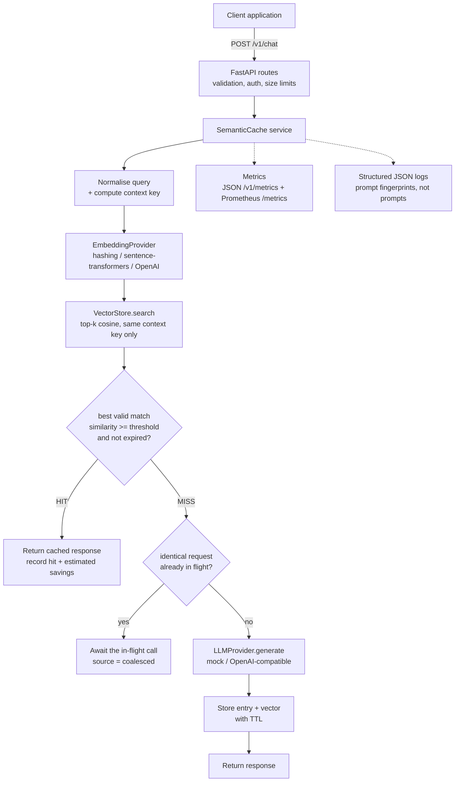

# Architecture

## Components

| Module | Responsibility |
|---|---|
| `api/routes.py` | HTTP <-> service translation only. No caching logic. |
| `api/schemas.py` | Pydantic request/response models (what `/docs` shows). |
| `api/errors.py` | Exception -> JSON error mapping; request-id + body-size middleware. |
| `cache/service.py` | The engine: lookup, threshold, TTL, single-flight, store, metrics. |
| `cache/identity.py` | Query normalisation and the cache context key. |
| `cache/vector_store.py` | `VectorStore` interface + exact NumPy implementation with persistence. |
| `cache/entry.py` | `CacheEntry` data model. |
| `embeddings/` | `EmbeddingProvider` interface + hashing, sentence-transformers, OpenAI. |
| `providers/` | `LLMProvider` interface + mock and OpenAI-compatible providers. |
| `observability/` | JSON logging and metrics. |
| `main.py` | Wiring (`build_cache`, `create_app`), lifespan (load/save, cleanup task). |

The routes depend only on `SemanticCache`; the service depends only on the three interfaces.
Swapping FAISS/Qdrant for the NumPy store, or Gemini for OpenAI, means writing one class.

## Request lifecycle

1. **Validate** - Pydantic rejects unknown fields, blank messages and out-of-range parameters
   (422). Bodies over `MAX_REQUEST_BYTES` are rejected before parsing (413).
2. **Bypass check** - `use_cache=false`, or `temperature > CACHE_MAX_TEMPERATURE`, goes straight
   to the LLM and nothing is stored.
3. **Normalise** - NFKC, lower-case, collapse whitespace, strip trailing punctuation.
4. **Context key** - SHA-256 of `provider, model, system_prompt, temperature, max_tokens,
   namespace`. Search is restricted to entries with the *same* key (see below).
5. **Embed** the normalised query.
6. **Search** the top `CACHE_TOP_K` entries by cosine similarity (vectors are unit length, so a
   dot product).
7. **Decide** - walk the ranked hits; the first one with `similarity >= threshold` **and** not
   expired is served. An expired best match does not block a valid, slightly less similar one.
   Expired entries are never served, even if the cleanup task has not removed them yet.
8. **Miss** - if an identical (same context key + normalised text) request is already calling
   the LLM, await that call instead of making another. Otherwise call the LLM, store the entry
   with `expires_at = now + ttl`, and return.

## Cache identity (why the key is more than the prompt)

A cached answer is only valid if everything that shaped it is the same. Reusing an answer
produced by a different model, a different system prompt or a different `max_tokens` would be
a silent correctness bug, so those fields form the context key and partition the index.

`namespace` lets the caller add anything else that matters: tenant id (prevents one customer's
cached answer leaking to another), prompt-template version, locale, retrieved-document hash
for RAG, tool configuration, etc. Bump the namespace when you change a prompt template and
old answers stop matching automatically.

Not included, by design: the request's `ttl_seconds` and `use_cache` (they control caching,
not the answer).

## Failure behaviour

| Failure | Behaviour |
|---|---|
| LLM error / timeout | `ProviderError` -> 503 (retryable) or 502; nothing cached; concurrent followers get the same error. |
| Embedding error | Fail open: call the LLM, return the answer, do not cache it (no vector). Logged. |
| Vector store search error | Fail open: treated as a miss. Logged. |
| Vector store insert error | Answer still returned; `cache_entry_id` is `null`. Logged. |
| Unhandled exception | Generic 500 JSON with a request id; traceback only in server logs. |
| Leader request cancelled (client disconnect) | Followers detect the cancelled future and call the LLM themselves. |

A cache should never make the system *less* available than calling the LLM directly; hence
fail-open everywhere except the LLM itself.

## Concurrency

The service runs on a single asyncio event loop. Store operations are synchronous and contain
no `await`, so they are atomic with respect to other requests in that process.

**Single-flight** (request coalescing) is implemented for *identical* requests (same context
key and normalised text): N concurrent copies produce exactly 1 LLM call
(`tests/unit/test_service.py::test_concurrent_identical_requests_make_one_llm_call` and the
HTTP-level e2e test).

Limitations, stated plainly:

- Concurrent *paraphrases* ("What is ML?" and "Explain ML" arriving at the same instant) are
  **not** coalesced; both may call the LLM. Coalescing on similarity would require holding a
  lock across the embedding step and is left as future work.
- The cache lives in process memory. Running `uvicorn --workers 4` gives four independent
  caches. Scale out with a shared `VectorStore` implementation (Redis/Qdrant/pgvector).

## Persistence

If `VECTOR_STORE_PATH` is set, the index is loaded on startup and saved on graceful shutdown
as `entries.json` + `vectors.npy`. Writes are atomic (temp file + rename). `vectors.npy` is
loaded with `allow_pickle=False`, so a tampered file cannot execute code. The index is
discarded on load if the embedding model changed (vectors from different models are not
comparable). A crash loses entries created since the last clean shutdown.

## Eviction

`CACHE_MAX_ENTRIES` caps memory; when full, the least-recently-used entry (by
`last_accessed_at`, falling back to `created_at`) is evicted. A background task purges expired
entries every `CACHE_CLEANUP_INTERVAL_SECONDS`; `DELETE /v1/cache/expired` does it on demand.

## Embedding providers

| Provider | Semantics | Needs |
|---|---|---|
| `hashing` (default) | **Lexical**: feature hashing of stemmed content words, bigrams and character trigrams, with stop/question-framing words removed. Catches rewordings that share content words; misses synonyms (`car` vs `automobile` scores 0.0). | Nothing. Deterministic, offline. |
| `sentence-transformers` | Neural sentence embeddings (default `all-MiniLM-L6-v2`). Handles synonyms. | `pip install -e ".[sentence-transformers]"`, model download on first run. |
| `openai` | Any OpenAI-compatible `/embeddings` endpoint. | `OPENAI_API_KEY`. |

The hashing provider exists so the full system - including the test suite and CI - works with
zero setup. For real traffic, use a neural provider and re-tune the threshold; similarity
scales differ between models.
